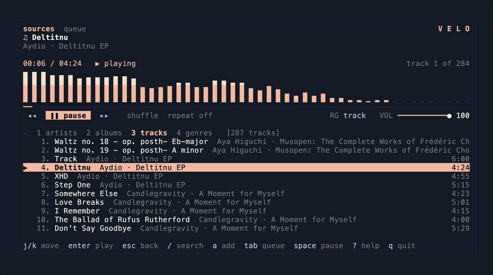
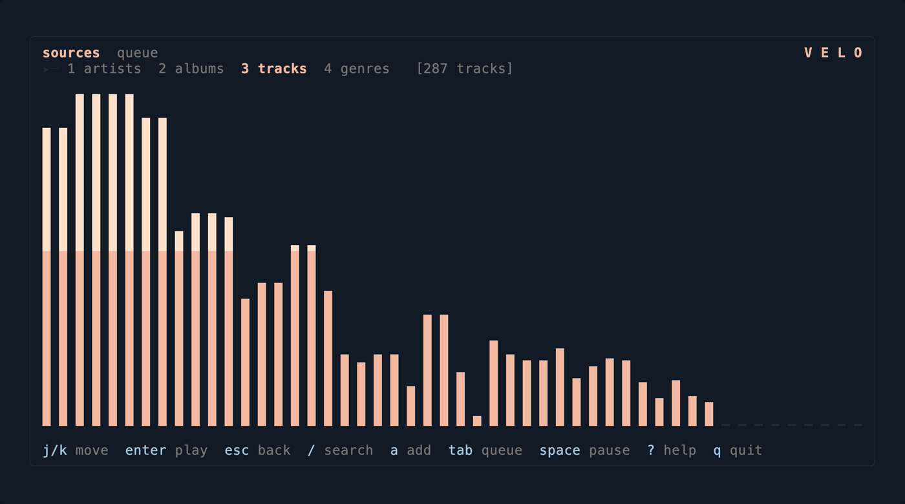
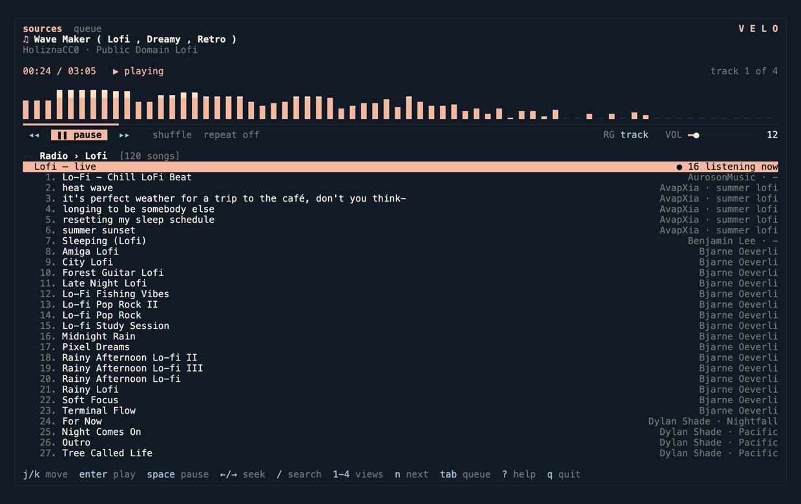

<p align="center">
  
</p>

# velo

[](https://github.com/alvaldes/velo/actions/workflows/ci.yml)

A single-binary music player for your terminal: point it at your music folder,
and it indexes your library from your files' own tags, browses by artist,
album, track or genre, plays gaplessly, and renders cover art — all from one
Rust binary, with no daemon and no server. A fuzzy search and an editable
queue make it a player you actually drive, not a playlist viewer.

The site, with a player you can press play on: <https://alvaldes.github.io/velo/>.



| The visualizer over the whole body (`V`) | A cliamp radio channel: the live row, then its songs |
|:--|:--|
|  |  |

The screenshots are velo 0.45.0 with the factory theme, playing CC0 tracks by
HoliznaCC0. The same screen in text, before anything plays:

```
╭──────────────────────────────────────────────────────────────────────────────╮
│ library  queue                                                       V E L O │
│ ♫ nothing playing                                                            │
│ enter plays the selection                                                    │
│                                                                              │
│ --:--   ■ stopped                                                            │
│ ──────────────────────────────────────────────────────────────────────────── │
│  ◂◂   ▶ play   ▸▸    shuffle  repeat off     RG track   VOL ━━━━━━━━━━━● 100 │
│                                                                              │
│ ▸─ 1 artists  2 albums  3 tracks  4 genres   [3 artists]                     │
│   1. Lo-Fi Scientists                                    2 albums · 3 tracks │
│   2. Nujabes                                               1 album · 1 track │
│   3. Poldoore                                             1 album · 2 tracks │
│                                                                              │
│ j/k move  enter play  space pause  ←/→ seek  / search  ? help  q quit        │
╰──────────────────────────────────────────────────────────────────────────────╯
```

While a track plays, the block on top names it — by its library tags, or by
its file name when it was given on the command line — counts the
clock against its length, fills the progress bar, and the primary button
turns into `❚❚ pause`. On a tall terminal a spectrum of the music sits
between the clock and the progress bar — in one of nine shapes: `bars`,
`bars-outline`, `wave`, `scatter`, `flame`, `matrix`, `scope`, `mirror`, or
`none`, chosen with `v`, the picker or the config file. On a short terminal
the block shrinks to three rows, then to one, before the list gives up any
of its own.

velo wears your terminal's colors: its background (translucency included)
and text, and the ANSI palette for everything else — magenta for the
accent, blue for keys and counts, bright black for what can be dimmed.

Every list marks the row that plays, and no other row: `▶` stands in the
first column of the row the transport stands on, while every idle row
carries two spaces there — the selection already has its own background, so
a bare `▸` would only repeat it, and the numbers, names and facts of the
rows beside it never move. The marker is the transport's state: a track
that paused carries `⏸` and the transport says `paused`. A station is a
live stream and cannot pause: while it plays, the transport says `● live`
and its row carries `▶`; when its stream has stopped, the queue's entry it
stood on carries `■` and the transport says `■ stopped`. A song marks its
row too: a channel's song — queued as a file whose path is its URL —
carries `▶` in the channel's list while it plays, matched by the same
station key a station is.

## Keys

Every key below is what the code does today.

| Key | Action |
|:--|:--|
| `j` / `↓`, `k` / `↑` | Move down / up; the lists wrap at their ends — `j` on the last row lands on the first, `k` on the first on the last — except the queue, which stops at its ends |
| `g` / `G` (or `home` / `end`) | First / last row |
| `pgdn` / `pgup` (or `ctrl+d` / `ctrl+u`) | A page of rows at a time, in every list that scrolls; a page never wraps |
| `enter` (sources) | Open the source under the cursor: `Local library`, `Radio`, `Recently played`, `Favourites` or `Playlists` |
| `enter` (library) | Open an artist, album or genre; play from the selected track onwards through the list it is in |
| `esc` / `backspace` | Back one level; from the top of the library, or when the radio closes, back to `Sources`. Closes the help overlay |
| `1` `2` `3` `4` | Library view: artists (artist → album → track), every album, every track, genres |
| `/` | Fuzzy search the whole library (`lofi` finds `Lo-Fi Scientists`); in the radio view, ask the directory for stations by name, across every country |
| `space` | Pause / resume |
| `←` / `→` | Seek 5 s back / forward; with `shift` on the arrow, 30 s |
| `:` (or `ctrl+j`) | Jump to a position in the playing track: a percentage of it (`70%`), a clock position (`1:20`, `1:20:30`) or a count of seconds (`90`); refused on a live station or an empty answer |
| `>` / `.` / `n` | Next track — from a live station, next goes to the first track of the queue |
| `<` / `,` | Previous track — it restarts a track already 3 s in |
| `z` | Shuffle what is left of the queue; again to put it back in order |
| `r` | Repeat: off → all (the queue again) → one (the track again) |
| `m` | Mono: both output channels carry the average of the mix — `(left + right) / 2`, never the sum, so the peak does not grow — applied after ReplayGain, before the samples reach the device, and toggled without restarting the stream. Refused while `bit_perfect` is on: the status line says so |
| `P` | Low power: the screen redraws at a quarter of its ordinary rate and the spectrum stays out entirely — its rows go back to the list. Playback, the clock, the volume, seeking and every other key behave exactly as they do today; only the redraw cadence changes. Press again to step back out, and the last state is remembered under `[ui] low_power` the way `z` remembers shuffle |
| `o` (or `ctrl+l`) | Set the library folder: the same prompt as the first run, at any time, tab completion included |
| `L` | The saved playlists source, straight from the library |
| `I` | Refresh the library index in the background; the title bar shows `⟳ indexing…` until it ends and the lists reload |
| `u` | Open a URL prompt: type an `http`/`https` URL and press `enter`. A plain stream — or a wrapper with a single entry — plays live as a radio station (`● live`); a wrapper listing several songs queues them as one finite list of tracks, the URL of each song its path. Nothing is saved — no station in `radio.toml` |
| `ctrl+i` | Describe the track in question — the one playing, or the row under the cursor when nothing plays — in a card: the path or remote URI, the format header's facts (container, codec, bitrate, rate, channels, length), what the index knows and the file's ReplayGain tags. `esc` closes it |
| `ctrl+s` | Save a remote track out — the one playing, or the row the cursor marks in the queue or in a list that holds tracks. A prompt asks for the destination, prefilled `~/Downloads/<the file's own name>` (the title the index or a wrapper carries when one is known, else the URL's own last segment); `enter` copies the cached bytes there off the event loop, the status line shows the progress it can honestly report and one last line says where the file landed, `esc` cancels. A local file — it is already on disk, copying it is `cp` — and a live station — a stream does not end, so there is nothing to save — are refused with their own lines; a destination that is already a file is refused in the card with the name kept, velo never overwrites; a failed copy says why and leaves no half file behind. The library and the cache are untouched either way: a copy out, not a move |
| `d` | Choose the audio output: a list of the machine's devices with the one in use marked, `enter` moves playback there keeping the position in the track, `esc` closes. The choice is remembered in `[audio] device` |
| `+` / `-` | Volume up / down, 5% at a time; `[` / `]` move it a single point for the levels in between |
| `tab` | One round trip: to the queue, and back to the screen you left — `Sources`, the library at its level, or the radio view with the place you were inside |
| `p` | The queue view — the working list, where `x` removes and `shift+↑`/`shift+↓` move; `tab` is the way back out |
| `a` | Append the selection to the queue — a track, or every track of an album or genre |
| `A` | Append the selection to the queue and start playing from the entry it landed on |
| `x` | Remove the selected entry from the queue (queue view); delete the playlist under the cursor, said in the status line (`Playlists` names list). Where nothing can be removed — a library row, a playlist's own tracks — one status line says so |
| `J` / `K` (or `shift+↓` / `shift+↑`) | Move the selected entry down / up (queue view); move the selected track down / up inside a playlist's track list, saved to `library.toml` at once |
| `S` | In the queue view: save the queue as a new playlist — a prompt asks for the name, `enter` saves, `esc` cancels, a taken name is refused in the card. On a track of the library: append that track to a playlist chosen from a small overlay of the saved names (`enter` applies, `esc` cancels) |
| `e` | On a playlist in the `Playlists` names list: rename it with a prompt, opened with the name as it stands; `esc` cancels |
| `v` | Cycle the visualizer — the shape the spectrum draws — through `bars`, `bars-outline`, `wave`, `scatter`, `flame`, `matrix`, `scope`, `mirror` and `none`, wrapping back to `bars`; the choice is written to `[ui] visualizer` |
| `ctrl+v` | Visualizer picker: one row per shape, `none` first. Moving the cursor applies the focused shape on the spot — the preview is the interface — `enter` keeps it and writes the choice, `esc` restores what was in force; every other key waits |
| `V` | The visualizer over the whole body: no list, no now-playing block, but the header and the footer stay. `V` again — or `esc` — returns to exactly the view it came from, and the transport keys keep working full screen: `space` still pauses, the arrows still seek, `n`/`.` still skip, the volume and `q` are not swallowed |
| `enter` (queue view) | Play the queue from the selected entry |
| `?` (or `ctrl+k`) | Help card: `j`/`k` (or `↓`/`↑`) scroll it and `g`/`G` (or `home`/`end`) jump to its ends; `/` filters it by key or description (`enter` keeps the filter, `esc` clears it, a second `esc` or `?` closes the help). The card keeps its full size however few rows the filter leaves, and every other key waits until it closes — `q` and `space` included |
| `ctrl+p` | Settings card: everything in `config.toml` — replay gain, repeat, shuffle, the theme, the `[ui]` switches and the visualizer and the library folder (the volume is not a row: it stays on `+`/`-`; the seven `[theme]` colours are the theme's inside and stay editable in the file; the read-only `version` row names the running version and whether a newer one exists). `j`/`k` (or `↓`/`↑`) move between the settings (the `sound`/`theme`/`screen`/`library`/`about` headers are never focused), `g`/`G` jump to the ends, `enter` or `←`/`→` step the focused row (`enter` on the `theme` row opens the theme picker — one row per theme, the cursor's move previews it on the spot, `enter` applies, `esc` restores —, `enter` on the `spectrum` row opens the visualizer picker the same way, and the `folder` row opens the library prompt), `esc` closes — and every other key waits until it does, `q` and `space` included |
| `R` | Radio view, straight from either screen: the shortcut for `Sources` → `Radio` |
| `f` | On a track of the library: mark it as a favourite — press again to unmark; the mark is kept in `library.toml` and the track shows `★` in every library list. In the radio view: favourite the selected station, or pin the selected country or region |
| `F` (radio view) | Filter the list already loaded, without asking the directory — `enter` keeps the filter, `esc` clears it |
| `N` (radio view) | The country list, with your own country first when it knows it |
| `ctrl+r` (radio view) | Refetch the directory for the place you are in: the country list, a region's stations or a tag's |
| `i` (radio view) | On a station marked `✗`: open a prefilled bug report in your browser — the station's name, codec and URL, the reason velo gave, and your velo version and platform. Nothing is posted: read the draft and send it |
| `q` (or `ctrl+c`) | Quit |

While a search is open, every printable key types into the query,
`backspace` deletes, `enter` plays from the selected result, and `esc`
cancels — leaving the browser exactly where it was. The queue only lets you
edit entries after the one playing: the playing entry cannot be removed and
nothing moves across it, and each refusal explains itself in the status line —
the same refusal when the entry that plays is a station. A station queued among
the tracks keeps its place and reads as live: its row shows the station's name
and the `● live` marker where a track shows its position. `next` while a station
plays leaves it for the first track of the queue — the stations you lined up for
the evening stay put — and when the queue holds no track, one status line says
so and the station keeps playing.

## Media keys

If the system has a media session to offer — macOS's media controls, a
Linux desktop's MPRIS — velo registers with it: the OS's play/pause, next
and previous reach the same actions the interface's `space`, `n` and `,`
perform, and velo publishes what is playing so the OS can show it — a
track's title and artist (its file name when the index never saw it), a
live station's announced ICY title or its own name, and nothing when
nothing plays. The keyboard keys themselves are untouched: the media keys
are the OS's, not the terminal's. Starting the client is best effort — it
lives on its own thread, never waits and never panics, and a launch
without a media session (headless, over ssh, no session bus) starts all
the same, saying at most one line.

The first screen is `Sources`: `Local library`, `Radio`, `Recently played`, `Favourites` and `Playlists`, with
the cursor already on the library. `Recently played` lists what `velo history`
reports — the history file's entries, newest first — and its rows play and queue
like any track. `Favourites` lists the tracks you marked with `f`, each showing
its `★`, playable and queueable exactly like any other track list. `Playlists`
lists your saved playlists by name with their track counts; `enter` on a name
opens its tracks in order, playable and queueable like any other list, and
playlists are created from the queue with `S`, appended to with `S` on a track,
reordered with `J`/`K`, renamed with `e` and deleted with `x` — everything
written to `library.toml` as it happens, so the names outlive the process. `esc` walks
back one level at a time; the top of the
library and the radio both land there, and a radio opened with `R` from the
library comes back to the library — the way out is always the way in. A
source's own keys stay its own once it is open. A launch that names files on
the command line skips the first screen: those files are what plays, and
there is no source to choose between.

## Privacy

velo sends no usage data: no analytics endpoint, no install id, no first-run
question to answer. It asks the network only for what you pointed it at — the
Radio Browser directory, the cliamp service, your own Subsonic server — plus
one request of its own, the update check: `GET
api.github.com/repos/alvaldes/velo/releases/latest`, no identifier attached,
once a day by default (`[update] check = "never"` turns it off for good, and
`weekly` makes it rarer). Nothing about what you listen to is sent anywhere.

## Install

**With Homebrew** — on macOS or Linux:

```sh
brew install alvaldes/velo/velo
```

The [tap](https://github.com/alvaldes/homebrew-velo) follows each release
within the hour; `brew upgrade velo` moves to the next one.

**With the install script** — on Linux or macOS:

```sh
curl -fsSL https://alvaldes.github.io/velo/install.sh | sh
```

It picks the release binary for the machine, checks it against the `.sha256`
CI published beside it, and puts `velo` in `~/.local/bin` — no sudo.
`VELO_INSTALL_DIR` names another directory and `VELO_VERSION` another tag
(`VELO_VERSION=v0.42.2`). A checksum that does not match installs nothing.

**Prebuilt release binary, by hand** — download `velo-<tag>-<target>.tar.gz` for your
platform from the repository's
[Releases](https://github.com/alvaldes/velo/releases) page, unpack it, and put
the `velo` binary on your `PATH`.

**From a clone, with cargo:**

```sh
git clone https://github.com/alvaldes/velo
cd velo
cargo install --path .
```

**From crates.io, once published:**

```sh
cargo install velo
```

Building from source needs Rust 1.88 or newer; the release binaries are built
by CI for `x86_64-unknown-linux-gnu`, `aarch64-unknown-linux-gnu`,
`x86_64-apple-darwin` and `aarch64-apple-darwin`.

## Quick start

```sh
velo --library /path/to/your/music --index   # point velo at your music, index it
velo --library /path/to/your/music           # open the browser
```

Every launch refreshes the index in the background: the interface is usable
at once, the title bar shows `⟳ indexing…` while the scan runs, and the lists
reload with the counts in the status line when it ends. `I` runs the same
refresh at any time. `ctrl+i` describes the track in question — the one playing, or the
row under the cursor when nothing plays — in a small card over the screen: the file's
container, codec, bitrate, sample rate, channel count and length read without decoding,
what the index knew and the ReplayGain tags the file carries, `esc` closes it.

Then, inside the interface: `enter` into an artist, into an album, `enter`
again to play — or `2` for every album, `3` for every track, `4` for genres
(read from the files' genre tags; `Dub / Trip-Hop` counts in both); `/` to
search; `←`/`→` to seek; `tab`, `a` to queue something
else without stopping playback. Files given on the command line play as one
gapless stream instead:

```sh
velo --info song.flac          # format, frame count, length
velo song.flac song.mp3        # open the interface over them
velo --play song.flac song.mp3 # play and exit when finished
```

## Radio

From `Sources`, choose `Radio` — or press `R` anywhere — for internet radio: the
[Radio Browser](https://www.radio-browser.info/)
directory — about 58,000 stations across 241 countries — plus the stations you add
yourself. It is a source beside your library and your Subsonic servers, not a
replacement for either. The directory's host is configurable — a `host` in a
`[radio]` table in the config file, a bare name with no scheme and no path —
and defaults to the community's round-robin across its mirrors,
`all.api.radio-browser.info`, so no single mirror's outage empties the view.

The first section is **cliamp radio** (issue #48): the channels of the
[cliamp](https://radio.cliamp.stream) radio service, another project's — shown
numbered `1.`, above the directory's own sections. Entering it asks the service for
its channels (`N tracks` on each row) and entering a channel opens the channel's own
screen: a **live row** first — `Lofi — live`, with `● N listening now` when the
service answered — and below it the channel's songs, `artist · album` beside each
title. `enter` on the live row plays the channel's stream through the path a station
already takes: `● live` in the transport, the ICY title, one retry, and the HLS
refusal. A song is an ordinary remote **file**: `enter` plays from it and `a` queues
it, both as a cached track, with a position and a seek. The section asks the service for two
requests when it opens and again on `ctrl+r`, and nothing on a timer; if the
service is down, a failing channel list leaves the section present but empty with
one line naming the reason, and a failing listener count only drops the `●`
numbers. Because the service is not velo's, the config carries a switch:
`cliamp = false` in the `[radio]` table hides the section entirely (shown by
default), so a dead service needs a config line, not a release.

The directory's sections come after it: the country browser, your home country with its regions,
your pinned places, the **stations without a country** — the ones you added by hand
and the favourites saved with no country code, so that radio is not only radio inside
a country — and the genres and tags. The favourites sit **below all of them**, behind
a dotted rule and their own `favourites` header, so the stations you actually listen
to are gathered at the end of the list instead of spread across countries. Those
sections are screens, not a single mixed list: a category lists categories, a country
lists its own stations, and neither borrows the other's rows.

A wait says so. While a directory request is in flight — a place's stations,
or one of the two indexes — the list says `⟳ loading…` and the footer says
the same, both going away when the answer lands; a live station that
takes a while to open is named in the status line (`velo: opening <name>…`) until the
player answers.

Browse by country (your own first, and its regions when the directory records
them), by the community's genres and tags, or search a name. Every list can be
ordered by votes, listeners, trend, name or nothing at all, and a place brings at
most 200 stations — the directory's catalogue is not something you scroll.

A station is a **live stream**, so it differs from a file in ways the interface
says out loud: there is no position and no total, the clock row reads `● live`
while it plays and `■ stopped` once its stream has stopped (a live stream
cannot pause), `←` and `→` refuse instead of pretending, and the title comes from the station's
own ICY metadata (`StreamTitle`) rather than from tags. A stream that fails — a
cut, a timeout, a station that answers with a playlist instead of audio — gets
exactly one retry before the queue moves on, and a station never joins the next
track as a gapless pair. A playlist wrapper (`.pls`, `.m3u`) is resolved one level
deep; an HLS manifest is refused with its own message before anything tries to
decode it, because its `.ts` segments are not audio this player can play.

A station **you** put into `radio.toml` that turns out to be a wrapper listing
**songs** — two or more playable entries — opens as that list instead of playing
live: one queue row per song, in the wrapper's order, each playable and seekable
as a track, with its duration taken from the file itself (the wrapper declares
none). The rule keys on the wrapper alone, not on any service: entries that are
relative paths resolve against the wrapper's own URL. The songs cache like any
remote track — the first play downloads into the same cache a Subsonic server
uses, and `velo --cache-clean` cleans it — and their identity is their
`https://…` URL everywhere: the history entry, a saved playlist. The title the
wrapper gives a song (`Artist - Title` in an `.m3u`, `Title<n>` in a `.pls`)
names it in the queue, the now-playing block and any list that shows it; those
names are session-scoped on purpose — a song velo has not expanded this session
shows its URL. The same rule answers a one-off URL typed at `u`: a plain stream
plays live, a wrapper listing songs opens as those songs — and nothing is
saved, the visit leaves no station behind. Opening a channel twice probes the wrapper once: the expansion's
verdict is remembered for the session, a failed one is never remembered (a
transient error stays retryable), and a plain stream, which never needed the
probe, gains nothing to remember.
A wrapper with one entry, a plain stream URL, and a wrapper that cannot be
expanded — unreachable, empty, no playable entry — behave as before: the first
two play live, and the third is one status line naming the station and the
reason, with nothing queued. The `a` key keeps queueing the station itself, so a
station in the queue still reads `● live`.

A station the directory's filter rejects is marked `✗` before you press `enter`:
either its URL is an HLS manifest, or this build has no decoder for the codec the
directory claims. The marker never leaves it at that: while the cursor rests on
the row, the status line names the station, says the reason in a couple of words —
`HLS manifest`, or `codec <name>` — and names the key that reports it
(`velo: HLS One cannot play (HLS manifest) — i reports it`), all on a line that fits
an 80-column terminal; the long sentence is what the report carries. It goes away
when the cursor moves on. Your own favourites and hand-added
stations are never **blocked** by that filter — you put them there deliberately, and
`enter` still tries them — but a station that cannot play is marked `✗` wherever it
appears, favourites included, and `i` reports it from there too. A station marked
`✗` is worth reporting as an issue: press `i` on the row and velo opens a
prefilled bug report in your browser — the station's name, codec and URL, the
reason velo gave, and your velo version and platform, all filled in for you
to read and send. velo itself holds no token and posts nothing; if the browser
cannot be opened, the report's URL lands on the status line so the issue can
still be filed by hand.

Stations are **not** in the library index: they are not scanned, not searched with
`/` from the library, and they never appear in the artist, album or genre views.
Your favourites, your pinned places and your own stations live in
`~/.config/velo/radio.toml`, deduplicated by URL and written atomically, so a bad
edit in `config.toml` cannot take them with it. A URL that is already a favourite
is unmarked by pressing `f` again, however it is spelled (`https://A.example/stream`
and `https://a.example:443/stream/` are the same station). A hand-added station
is where a channel of songs comes from too: point a `[[station]]` at a `.m3u`
that lists the channel's songs and `enter` opens the list (above), with nothing
about the service hardcoded anywhere — velo only ever reads what you wrote.

The country used for "near you" is **opt-in**: velo offers the question once, reads
it from your locale (`LC_ALL`, `LC_MESSAGES`, `LANG`) and nothing else — no geo-IP,
no location service, and a `n` leaves the feature off for good. It is a
convenience for finding your own country in a list of 241, not a gate: the country
browser, the pins and the catalogue work the same either way.

One-shot probe: `velo --radio-test <URL>` answers "can I listen to this station?"
without the interface — headless, so it works over ssh like `--subsonic-test`. It
resolves one wrapper level and prints the URL the station really points at, each
redirect hop, the response's `content-type` and `icy-metaint`, the codec it
decoded and whether this build can play it, then decodes the first seconds of
audio and reports how much came out and at what sample rate and channel count:

```
url: http://stream.example.com/live
wrapper: http://stream.example.com/audio
redirects: none
content-type: audio/mpeg
icy-metaint: 8192
codec: mp3 — this build can play it
decode: 2.0 s, 44100 Hz, 2 ch
```

It exits `0` when the URL plays end to end, `1` with a one-line reason on
stderr when it does not (a 404, an unreachable server, an HLS manifest, a body
nothing here can decode), and `2` when the URL is missing.

What it does not do: no radius search around your location (the directory records
coordinates for about 12% of stations, so such a search would silently hide most of
the catalogue), no scrobbling to a remote account, and no station art — the
directory has none per station.

## ReplayGain

velo can measure a file's loudness the EBU R128 way and write the ReplayGain
2.0 tags the player then applies (see `replay_gain` in the configuration):

```sh
velo --replaygain-scan album/*.flac          # measure and print — a dry run
velo --replaygain-scan --apply album/*.flac  # write the tags
```

Every file passed in one invocation is measured as one album: the track gain
come from each file's own measurement, the album gain from all the files'
blocks pooled and gated together (EBU R128 / ITU-R BS.1770-4, −18 LUFS target,
absolute gate −70 LUFS, relative gate −10 LU). The dry run is the default —
nothing is ever written without `--apply`. A file that already carries artist,
title, comments or cover art keeps every one of them; only the four
`REPLAYGAIN_*` keys are added. The written peak is a **true peak**: the signal is
oversampled 4× with the interpolating filter ITU-R BS.1770-4 Annex 2 specifies,
and the largest absolute value of that oversampled signal is what gets written —
which catches the inter-sample overshoot a sample peak misses, and which is what
the clipping cap further up respects.

Each file is reported as `ok`, `skipped (no audio)` or `failed (reason)`; one
bad file never stops the run, and a read-only file is reported, not forced.

## Recently played

velo writes what begins playing to `~/.config/velo/history.toml` (beside
`config.toml`, or `$XDG_CONFIG_HOME/velo/history.toml` when that is set):
newest first, one entry per path — playing a track again moves it up instead
of duplicating it — capped at 500 entries, and a seek is not a new beginning.
Reading it needs no interactive terminal:

```sh
velo history         # one line per entry, newest first
velo history --json  # the same entries as a JSON array, for a script
velo history clear   # empty the history
```

The history is written by the interface; the one-shot `--play` mode writes
nothing. `history` is a subcommand now: a file that happens to be named
`history` is opened with a path (`velo ./history`).

Radio stations are recorded here too: they are listed in `Recently played`
beside the tracks, with their own name and the note `radio`, and opening one
plays the live stream. In `--json` output a station carries
`"kind":"station"` where a track carries `"kind":"file"`.

## Playlists in and out

Saved playlists — the ones under the `Playlists` source, stored in
`library.toml` — can be imported from and exported to the playlist files
other players write. Both verbs are headless: no terminal, no library index,
so they work over ssh:

```sh
velo playlist import ~/music/noche.m3u     # .m3u, .m3u8 and .pls all read
velo playlist export Noche ~/backup/noche.m3u
```

An import saves a new playlist named after the file's stem (`noche.m3u`
becomes `noche`), refusing a name that is already taken. Relative entries
resolve against the playlist file's own directory; absolute ones stay. Entries
whose file is gone are reported, not dropped silently — and not stored:

```
1 of 3 entries are gone
/Users/you/music/old-take.flac
imported "noche" with 2 of 3 entries
```

A playlist whose every entry is gone is refused — nothing to save. An export
writes an `.m3u` with `#EXTM3U`/`#EXTINF` lines and absolute paths, exactly
the shape the import reads back, so a round trip keeps the playlist's tracks
and their order. An unknown name is refused.

## Configuration

Everything velo keeps lives in one directory, `$XDG_CONFIG_HOME/velo` (else
`~/.config/velo`):

```
config.toml      # everything below, written on the first launch
radio.toml       # the stations you kept, and the format to add one by hand
library.toml     # marked tracks and saved playlists, with the format
history.toml     # what played, newest first — appears with the first track
themes/*.toml    # one file per theme; velo.toml ships with velo's palette,
                 # "default terminal.toml" with the terminal's own
```

The first three are written when velo starts for the first time and never over
a file that is already there, so nothing has to be created by hand.
`config.toml` carries every key at its default value with a short comment per
key, so everything below can be changed from it; `radio.toml` and
`library.toml` are rewritten whole each time velo saves into them, so their
comments are a starting point. Everything below can also be changed while velo runs: `ctrl+p` opens the
settings card (a smaller card shaped like the help), where the
ReplayGain mode, the repeat and the shuffle, the theme (chosen in its own
picker), the transparent-background switch — the row directly below the
theme, shown `on`/`off`, and flipping it repaints with the terminal's own
background at once, no restart needed — the visualizer (its own picker
too) and the `[ui]` switches and the
library folder can be stepped
through live — each change applies on the next frame and is written to
this file key by key, just as if the matching key had been pressed. An existing file is
never overwritten or reformatted: every value velo
saves itself is written key by key, leaving your comments and your ordering
alone.

| Key | Meaning | Default |
|:--|:--|:--|
| `library` | The root folder to index and browse: an absolute path, `~/...` (your home) or a path relative to the directory velo starts in | none — written commented out (`# library = "~/Music"`) |
| `bit_perfect` | Decoder samples reach the device unmodified: no resampling, no ReplayGain, and the volume is pinned to 100%. A track at another rate reopens the device at its own rate (a small gap at that boundary); channel layouts still map; when the device has no such output, velo falls back to converting and says so once | `false` |
| `replay_gain` | ReplayGain mode: `track` (use the track's own gain), `album` (album gain, falling back to the track's), or `off` | `track` |
| `[radio]` | The internet radio directory's host: `host`, a bare name — no scheme, no path — to pin one Radio Browser mirror | `all.api.radio-browser.info` — the community's round-robin across its mirrors |

### `[state]` — where the next launch begins

| Key | Meaning | Default |
|:--|:--|:--|
| `volume` | Start level, `0..=100`. The number is what you see; the samples carry its cube — the perceptual curve `(percent / 100)³` — so the steps match hearing: `0` is silence, `100` is unity, and `bit_perfect` pins it to 100 | `100` |
| `shuffle` | Whether the queue is shuffled | `false` |
| `repeat` | What follows the end of a track: `off`, `all` or `one` | `off` |
| `view` | `library` or `queue`. Retired: read for compatibility — an existing value still parses — but no longer written or applied; it does not choose the screen. A launch opens `Sources` and `Local library` always starts at the library | `library` |
| `browse_by` | The library view: `artists`, `albums`, `tracks` or `genres` | `artists` |
| `artist`, `album`, `genre` | The node that was open inside that view — `album` always belongs to `artist` | absent |

velo keeps this table up to date as you listen: the volume when it changes,
the library view and the node when you move, the shuffle and the repeat when
you toggle them. The next launch opens on `Sources` and comes back to this when
you enter `Local library`. `view` is no longer written or applied: a
hand-written one — `library`, `queue` or even `sources` — still parses and is
ignored, because every launch opens `Sources`. The queue and the track that was
playing are not kept. `volume` used to live at the top level of the file; it
is still read there and moves under `[state]` the first time velo saves one.

### `[theme]` — the colours

Every value is `"#rrggbb"`. `"reset"` means the terminal's own colour and
is allowed for `background` and `text` only — every other slot needs a
hex colour.

| Key | Meaning | Default |
|:--|:--|:--|
| `background` | The screen behind everything | `#141c28` |
| `text` | Body text and the values in a list | `#f4f0e2` |
| `dim` | Hints and everything that should recede | `#767676` |
| `accent` | Borders, titles, the focused row and the selection | `#f4baa3` |
| `secondary` | The keys and labels next to the values | `#a6c8e2` |
| `border` | The panes that are not in focus | `#252939` |
| `ink` | The text drawn on top of `accent` | `#000000` |
| `transparent_background` | `true` puts the terminal's own background back behind everything — it shows through wherever the terminal is transparent, whatever the theme says. `false` and absent change nothing | `false` |

The brighter shade behind the accent is derived from `accent`, not written.

A theme can also be a file of its own, named after the theme, dropped into
the `themes/` folder beside this one:

```
$XDG_CONFIG_HOME/velo/themes/<name>.toml   # else ~/.config/velo/themes/<name>.toml
```

A theme file carries the same seven colour keys as the `[theme]` table, and
`[theme] name = "<name>"` selects it. The palette velo draws with layers in
one order: the factory theme (`velo`, which always exists), then the
selected theme file, then the `[theme]` colour keys of this file that differ
from the built-in defaults — a one-off change still wins, without copying a
whole theme, and the defaults the generated file writes are documentation,
not choices: they never mask a selected theme. That covers the values velo
itself wrote before its palette had colours of its own — `reset` for
`background` and `text`, `#af00af` for `accent`, `#5f87d7` for `secondary`
(issue #62). No name at all is the one path that layers every key, so an
older config with no `[theme] name` keeps exactly the look it describes;
the `default` alias is a name like any other and drops those values too. A name that
is not on disk falls back to the built-in and says so once; a theme file
that does not parse, or carries a colour that does not, is reported naming
the file and the key, and the built-in is used. velo always starts.

Two themes ship with velo and are recreated when missing, never over a file
you edited: `velo` — velo's own palette, the built-in one, carries its own
colours: a dark background, warm text and pinkish accents, no longer the
terminal's own — and `default terminal`, whose seven colours are all
`reset`, the terminal's own, so velo draws with exactly the palette your
terminal already has — the way to get the look velo had before issue #57.
A theme file accepts `reset` in every slot. `default` is an invisible
alias: `[theme] name = "default"` — what older configs carry — still selects
velo's palette, but the alias gets no row in the picker; a
`themes/default.toml` you write wins over the alias, like any file named
after a factory theme.

In the settings card (`o`) the `theme` row shows the theme applied right
now, and `enter` on it opens the theme picker: a small card with one row
per theme — `velo` first, then the built-in catalogue sorted by name,
then every theme file of the folder that is not one of them. A file named
like a factory theme takes that theme's row, so no name is listed twice.
Moving the cursor (`j`/`k` or the arrows, which wrap at the ends) applies
the focused theme at once — the preview is the interface, every card and
list repaints with it. `enter` keeps the theme and writes `[theme] name`
(the file only when the theme actually changed); `esc` closes the picker
and restores exactly the palette that was in force when it opened,
`[theme]` overrides included — `transparent_background` included, so with
it on no move ever repaints the background. Every other key waits while the
picker is open.

Twelve themes are built in, embedded in the binary: `catppuccin-latte`,
`catppuccin-mocha`, `default terminal`, `dracula`, `gruvbox-dark`, `monokai`,
`nord`, `one-dark`, `one-light`, `solarized-dark`, `solarized-light` and
`tokyo-night`. `velo` is not one of them — it stays the palette velo has
always drawn with.

### `[ui]` — what is drawn

| Key | Meaning | Default |
|:--|:--|:--|
| `cover_art` | Draw the cover art pane at all | `true` |
| `spectrum` | Legacy switch for the spectrum band. When `[ui] visualizer` is absent: `false` is the `none` visualizer, `true` and absent are `bars`. When `visualizer` is present it wins | `true` |
| `hints` | Draw the key hints on the last row | `true` |
| `top_bar` | Draw the tabs and the `V E L O` name | `true` |
| `advisories` | Let the status line explain why something is not drawn — today, a cover the window is too small for. Errors and ordinary messages are never silenced | `true` |
| `view_numbers` | Number the library views in the header (`1 artists  2 albums  3 tracks  4 genres`) | `true` |
| `low_power` | Start in low power: a quarter of the redraw cadence and no spectrum, playback unchanged. `P` toggles it while playing and writes this key | `false` |
| `visualizer` | The shape the spectrum draws: `bars` (filled bars per band), `bars-outline`, `wave` (one line undulating with the envelope), `scatter` (a dot per band), `flame` (peaks falling back over time), `matrix` (columns raining down), `scope` (the raw waveform), `mirror` (bars mirrored from the centre) or `none` (the band's rows go back to the list). `v` cycles and writes this key; the picker applies on the spot and writes on `enter` | `bars` |

Precedence: `--library` (expanded the same way) beats the config file. With
no library set, the interface no longer demands a folder: when a `[subsonic]`
server is configured, the synced index *is* the library and `/` searches it;
when neither a library nor a server is configured, one sentence in the
interface says what to set up. `o` (or `ctrl+l`) still opens the folder prompt
at any time — it starts at `~/`, which cannot be deleted, and `tab` completes folder
names the way a shell does (several matches are listed under the field). A
path that is not a directory is refused in the prompt; an accepted one is
saved to the file as `library = "~/<what you typed>"` (every other line
is kept) and indexed right away; `esc` skips it. `velo --index` without a
library exits 2 and names the key and the flag. An unknown key is an error
naming the key; a bad value names the file and the line.

### `[audio]` — the output device

| Key | Meaning | Default |
|:--|:--|:--|
| `device` | The audio output to open, by the name the system reports for it — the one `d` lists. Blank or absent means the default device | none — the system's default |

`d` changes it while velo runs, keeping the position in the track, and writes
the name here only when it changed. A name the machine no longer has falls back
to the default device with one notice in the status line, never a refusal to
start; a device that refuses to open leaves the current output playing.

### `[update]` — knowing a newer velo exists

| Key | Meaning | Default |
|:--|:--|:--|
| `check` | How often velo may ask GitHub whether a newer velo is out: `daily`, `weekly` or `never` — `never` means no request at all | `daily` |
| `last_check` | When the check last asked, as unix seconds — written by velo itself, never edited by hand; delete the line to make the next launch ask at once | absent |

A due check is one request to `https://api.github.com/repos/alvaldes/velo/releases/latest`
on its own thread, off the event loop; it says nothing while it runs, says one
line in the interface when a newer version exists, and is silent on any
failure — no retry storm, no error line. The settings card's `version` row
(`ctrl+p`, under `about`) always names the running version, and the newer one
when a check found it. velo never downloads, verifies or replaces itself.

To ask for a check yourself: `velo update` in the shell asks now, whatever
`check` and `last_check` say, and answers on stdout — the running version,
the newest release, and one of two verdicts: up to date, or a newer version
plus how to get it (`brew upgrade velo` for a Homebrew install, the release
archive otherwise). Exit 0 for either verdict; a request or an answer that
failed is one line on stderr and exit 1. `enter` on the `version` row of the
settings card asks the same way in the interface, and its answer lands like
the automatic one's: the status line, the row, and the refreshed
`last_check`. Neither route ever downloads or replaces the binary.

### Subsonic servers (early access)

velo talks to any server that exposes the Subsonic API: Navidrome, Airsonic,
Gonic and the ones that ship the API as an add-on. It does not talk to Plex,
Spotify, Tidal, Qobuz, YouTube or the rest of the services cliamp lists —
each speaks its own protocol and several only serve DRM-protected audio, and
a client per service is not something one binary without a daemon carries.
This is early access, and playback works by caching: what exists today is
the connection and its authentication, one command that answers
"can I use this server?", one command that syncs the server's library into
the index so browsing and fuzzy search reach it, and playback of a remote
track through that cache:

```sh
velo --subsonic-test
velo --sync
```

`--subsonic-test` prints the server's type, version, API version and the
OpenSubsonic extensions it advertises, says which authentication it used and
whether it worked, and exits `0` on success and `1` with a one-line reason on
failure. It needs no interactive terminal, so it works over ssh.

`velo --sync` fetches the server's albums (`getAlbumList2`, paged, and one
`getAlbum` per album — never one request per track) and writes them as rows
of the same index the local scan fills, marked with their source
(`subsonic:<host>`). It then prints the counts per source:

```
synced subsonic:music.example.com: 3212 tracks, 310 albums, 4 removed, 311 requests
local: 104 tracks · subsonic:music.example.com: 3212 tracks
```

Syncing is explicit — it never runs on startup. A failed sync writes
nothing; a successful one also removes this server's rows the server no
longer holds (the removed count says how many). The remote rows appear in
the artist, album, track and genre views and in `/` search like local ones,
and pressing `enter` (or `a`, to queue one) plays a remote track like a
local one.

### How remote playback works

| `ctrl+s` | Save a remote track out — the one playing, or the row the cursor marks in the queue or in a list that holds tracks. A prompt asks for the destination, prefilled `~/Downloads/<the file's own name>` (the title the index or a wrapper carries when one is known, else the URL's own last segment); `enter` copies the cached bytes there off the event loop, the status line shows the progress it can honestly report and one last line says where the file landed, `esc` cancels. A local file — it is already on disk, copying it is `cp` — and a live station — a stream does not end, so there is nothing to save — are refused with their own lines; a destination that is already a file is refused in the card with the name kept, velo never overwrites; a failed copy says why and leaves no half file behind. The library and the cache are untouched either way: a copy out, not a move |
track is a copy out, never a move: `ctrl+s` names a destination and the
cached bytes are copied there (a cache hit costs no network, a miss is the

Playing a remote track is cache-on-play: the track's original bytes are
fetched once with `stream?id=<id>&format=raw` (the server is asked for no
transcoding, so what lands on disk is what it holds) and then played from
that file. Seek, gapless, bit-perfect and ReplayGain-from-tags all keep
working, because the audio path opens a file either way. A cache hit needs
no network at all; a download that fails skips that track with the reason in
the status line and the queue keeps going — a network dying mid-album does
not end the session. While the queue is fetching a track it has not cached
yet, the status line carries `⟳ fetching <name>…` — from the moment `enter`
is pressed, not a minute later: the event loop never waits for the
download, the first fetch runs on a worker while the interface keeps
drawing, and the stream starts by itself once the file is on disk — until
the track starts sounding, a wait that is real for a channel's six-megabyte
song. A second play, skip or seek while one fetch runs supersedes it, so
only ever one wait is in flight; a fetch that fails says why in one line
and leaves the queue standing; a cache hit, being instant, shows nothing,
and a failed *producer* fetch keeps its own skip report.

The cache lives at `$XDG_CACHE_HOME/velo/subsonic`, else
`~/.cache/velo/subsonic`; each file is named after a hash of the track's
stream URL. It is capped at 2 GiB: after each download, when the directory
holds more than that, the oldest files (by modification time) are removed,
whole files only, until it is under the cap again — the file that was just
downloaded is never the one removed, so playing one enormous track cannot
evict the very thing it is playing. The covers cache is capped the same way
at 256 MiB. To empty both caches on demand, run `velo --cache-clean`: it
prints, per cache, how many files and how much space it freed and touches
nothing outside the two directories. A radio channel's songs (see Radio)
cache into the same directory the same way — no server needs to be
configured for that — so `--cache-clean` cleans both kinds alike.

### Remote covers and scrobbling

A remote track's cover comes from the server too. The sync stores each
song's `coverArt` id (the song's own, else its album's) in the index; when a
remote track plays, the interface fetches it once with
`getCoverArt?id=<cover_id>&size=600` into the covers cache —
`$XDG_CACHE_HOME/velo/covers`, else `~/.cache/velo/covers`, one image file
per cover id — and draws it exactly like a local track's cover. The fetch
runs off the drawing path, so a slow or missing cover means no cover, never
a stall or an error. A local track's cover keeps coming from its tags or
folder.

While a remote track plays, velo tells the server: `scrobble` with
`submission=false` when the track starts (now playing), and one
`submission=true` once it has played long enough to count — half its
duration or four minutes, whichever comes first, the same rule the servers
themselves apply. Scrobbles are sent from a background thread and a failing
one is never shown; local tracks are never scrobbled.

Add the table to the same `config.toml` (it must come after the other keys;
`url` and `user` are required when the table exists):

```toml
[subsonic]
url = "https://music.example.com"
user = "you"
# api_key = "the-key-from-the-server"   # see below
# insecure = false                      # true accepts a self-signed certificate
```

The secret is resolved in this order: `api_key` in the table, then the
`VELO_SUBSONIC_SECRET` environment variable, then the first line of the file
`$XDG_CONFIG_HOME/velo/subsonic.key` (else `~/.config/velo/subsonic.key`),
which you create yourself. When that file is readable by group or others,
velo warns and names the path and the mode — restrict it with `chmod 600`.
The warning is said where you are looking: once, in the interface's status
line, when velo starts with a Subsonic server configured (and again on
stderr for `velo --subsonic-test` and `velo --sync`).

The wire format is JSON; a server too old to answer JSON is reported as too
old, never parsed as XML. When the server advertises the `apiKeyAuthentication`
extension the secret is sent as an API key, otherwise as token authentication
(`t = md5(password + salt)` with a fresh salt per request). An unreachable
server is reported as unreachable — never as a credential problem.

## Requirements

- Linux or macOS. Windows is untested.
- To build from source on Linux, the ALSA development headers
  (`libasound2-dev` on Debian/Ubuntu); the audio output goes through cpal.
- **Opus needs one of two things at build time**: `cmake` (used to build the
  bundled libopus from source), or a system libopus that `pkg-config` can find
  (`brew install opus`, `apt install libopus-dev`) — in which case that one is
  linked statically and cmake is never called. Either way nothing is needed at
  runtime. Without both, the build stops in `audiopus_sys` with a message about
  cmake, which is the honest place for it to stop. **With CMake 4** (the current
  release) the bundled libopus needs one more word, because its build files
  predate CMake 3.5 and CMake 4 refuses those by default:
  `CMAKE_POLICY_VERSION_MINIMUM=3.5 cargo install velo`. A clone of this
  repository carries that setting in `.cargo/config.toml` already; a published
  crate cannot, which is why it is written here.
- A terminal. The interface needs an interactive terminal and refuses to run
  otherwise.
- Cover art is drawn when the terminal speaks the kitty, sixel or iTerm2
  protocol and the window is at least 100×28. Without one of those protocols
  there is no art pane at all — the layout is unchanged, and the status line
  says why a cover is hidden rather than faking one with half-blocks (a line
  `[ui] advisories = false` silences). The
  cover is the picture embedded in the track or, when it has none, a
  `cover`, `folder` or `front` `.jpg`/`.png` in the track's folder.

## Exit codes

| Code | Meaning |
|:--|:--|
| `0` | Success, including `--help` |
| `1` | A missing file, a missing library root, a non-interactive terminal, a playback error, or `--mono` together with `bit_perfect` in the config |
| `2` | A usage error, or a config file that cannot be read or parsed |

When `replay_gain` is `track` or `album`, every track's ReplayGain tags are
read at playback time and the gain is applied to the audio with clipping
protection: a track that declares its own peak is never pushed past full scale.
Tracks without usable tags play unchanged; a wrong tag value is ignored rather
than misapplied. To fill those tags in from a measurement, see
`--replaygain-scan` above.

Mono folds the mix into both channels as their average — `(left + right) / 2`,
never a sum, so the peak does not grow. `velo --mono` starts a session that way
and `m` toggles it while playing, without restarting the stream; it is a step
in the sample path after ReplayGain is applied, and it is refused while
`bit_perfect` is on — one line at startup, or the status line on `m` — instead
of being quietly applied. Nothing about it is persisted: the setting dies with
the session.

Low power is the screen's throttle: `velo --low-power` starts a session
that redraws at a quarter of its ordinary rate — 400 ms instead of 100 ms,
132 ms instead of 33 ms while bars were animating — and leaves the spectrum
out entirely, its rows going back to the list. Playback, the clock, the
volume, seeking and every other key are unchanged. `P` toggles it while
playing and the last state is remembered under `[ui] low_power`, the way
shuffle is remembered under `[state]`.

## Not yet

Honest list; none of these exist behind a flag:

- Subsonic/Navidrome, still early access: the connection, authentication,
  `velo --subsonic-test`, `velo --sync`, `velo --cache-clean`, cache-on-play
  playback with capped, self-pruning caches, remote covers and scrobbling
  all exist (see above). Streaming over HTTP ranges (playing before the
  whole track is on disk) is a later optimisation.
- Playlists: saved, named and reordered in `library.toml` now (see
  `Playlists` under the keys); a playlist editor beyond `x`/`e`/`J`/`K` is
  not here yet.

MP3, FLAC, M4A/AAC, OGG Vorbis, OGG Opus and WAV are what plays today, decoded
with symphonia 0.6 (Opus through a statically linked libopus behind `audiopus`,
pinned exactly at `0.3.0-rc.0` because that is the version whose `audiopus_sys`
builds libopus with cmake instead of autotools — an RC that does not drift is
worth more than a stable version that needs `autoconf`, `automake` and
`libtool` on every machine that installs this). No dynamic dependency. Sample
rates are
converted to your output device; channel layouts are not converted, except
mono, which plays through every output channel — a layout that would need a
real downmix (5.1 into stereo, say) is skipped with an announcement instead of
being silently averaged away.

Gapless joins trim what the encoder inserted, so a seam carries music only: for
MP3 the LAME tag's delay and padding are honoured, and for M4A/AAC — where
symphonia reports neither, measured on 0.5.5 and 0.6.1 alike — the priming is
read from the container itself
(the `elst` edit list, or an `iTunSMPB` tag when one is present) and trimmed.
Durations and seeks count content frames, not the raw encoded frames. A seek
also discards the codec's own declared warm-up after the jump — for Opus, the
normative pre-skip (RFC 7845) that the decoder re-runs after a reset — so the
stream resumes with the music, not the decoder's re-priming.

With `bit_perfect = true` in the config, sample rates are not converted
either: the device is reopened at each track's own rate, so the decoder's
samples reach it unmodified. ReplayGain is skipped and the volume is pinned
to 100%, because both would scale the samples; `+`/`-` cannot move it, and
one status line explains that. The reopen costs a small gap between tracks of
different rates; consecutive tracks that share a rate stay one continuous
stream, and channel layouts still map the way they do without the setting.
When the device has no output at a track's rate, velo falls back to
converting and says so once — a track is never lost to bit-perfect mode.

## Contributing

Two commands get you from a clone to a running binary, and the third checks your
change the way CI will:

```sh
cargo build --release
./target/release/velo ~/Music
cargo fmt --all -- --check && cargo clippy --all-targets -- -D warnings && cargo test
```

`CONTRIBUTING.md` has the platform dependencies, the commit convention, and what
a reviewable slice looks like. Bug reports and feature requests have templates;
a report that includes your platform, your terminal and `velo --info` is worth
ten without them.

## License

MIT — see [LICENSE](LICENSE).
